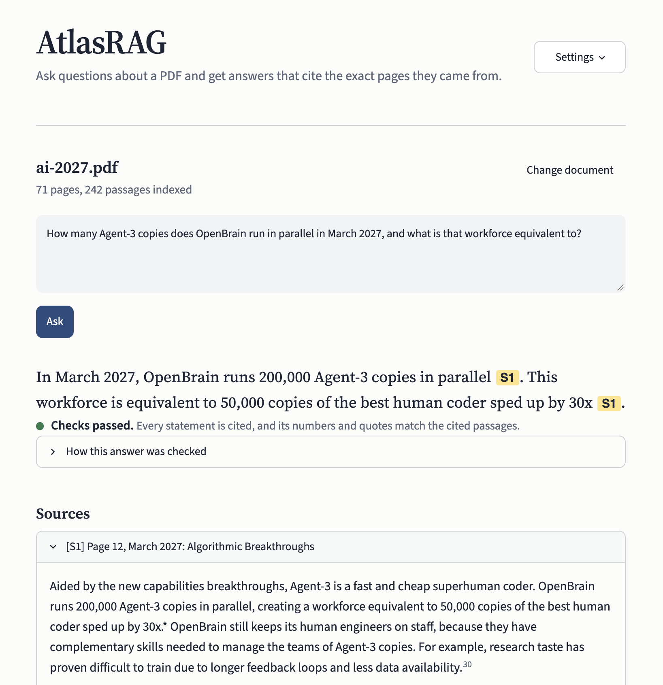

# AtlasRAG

[](https://github.com/hamzehjarrarr/AtlasRAG/actions/workflows/tests.yml)


**A local-first PDF research assistant with hybrid retrieval, cross-encoder
reranking, cited answers, and automated answer verification.**

Upload a PDF, ask questions about it, and get answers that cite the exact
pages they came from. Every answer is checked automatically for invalid
citations, uncited claims, numbers that don't appear in the cited source,
and quotations that aren't verbatim. Everything runs on your own machine:
no external LLM API, and documents never leave it.



## Highlights

- **Structure-aware PDF ingestion**: headings, footnotes, page
  continuations, running headers, and scientific notation (`10^27`) are
  handled explicitly, so chunks follow the document's sections.
- **Hybrid retrieval**: BM25S lexical search and BGE-M3 dense embeddings
  (stored in Qdrant), combined with Reciprocal Rank Fusion.
- **Cross-encoder reranking**: the top 20 candidates are rescored by a
  MiniLM cross-encoder before the best 5 reach the model.
- **Grounded generation**: a local Ollama model answers only from the
  supplied passages and cites each claim as `[S1]`, `[S2]`, and so on.
- **Deterministic verification**: citation validity and coverage, numbers
  (including currency, scales, percentages, and multipliers like `30x`),
  verbatim quotes, and clean "insufficient evidence" refusals.
- **Measured**: a labelled question set and evaluation script report
  retrieval and answer quality, with and without reranking, and compare
  prompt variants on the same questions.

## Results

Evaluated on the 71-page [AI 2027](https://ai-2027.com/) scenario
(242 chunks) with [`eval/questions.json`](eval/questions.json): 18
answerable questions, each labelled with the exact evidence phrase, plus 4
questions the document cannot answer.

Everything runs on a MacBook with deliberately small models: a 4B
generator and a 22M-parameter reranker.

### Retrieval

| Configuration | Hit@1 | Hit@5 | MRR |
|---|---|---|---|
| Hybrid (BM25S + BGE-M3, RRF) | 61% | 100% | 0.78 |
| Hybrid + cross-encoder rerank (used) | 67% | 94% | 0.79 |

Hybrid retrieval puts the evidence in the top 5 for every question. The
small MiniLM reranker moves more evidence to the top position (61% → 67%)
but pushed one passage out of the top 5.

### Answers (qwen3:4b-instruct)

| Metric | Result |
|---|---|
| Answer accuracy | 78% |
| Verification checks passed (answerable) | 78% |
| False refusals | 0% |
| Correct refusals (unanswerable) | 100% |
| Median latency | 5.4s |

An answer counts as correct only when it contains every expected value
and neither refuses nor hedges. The 4 questions the document can't
answer were all declined rather than guessed.

### Prompt comparison

Four prompts were run against the same questions with
`eval/evaluate.py --prompt` ([`eval/prompts/`](eval/prompts/)):

| Prompt | Accuracy | Checks passed | False refusals | Correct refusals |
|---|---|---|---|---|
| v1: original, long rule list | 78% | 72% | 0% | 75% |
| **v2: concise rules (used)** | **78%** | **78%** | **0%** | **100%** |
| v3: v2 + "don't refuse" rules and a dated example | 67% | 67% | 17% | 100% |
| v4: minimal, one example | 72% | 72% | 28% | 100% |

v1 matched v2's accuracy but invented an answer to one unanswerable
question. Adding explicit "don't refuse" guidance (v3) or shortening the
prompt (v4) made the 4B model refuse more answerable questions, not fewer.

### What still fails

Four questions fail under every prompt. In each, the passage states the
fact, but not in the words of the question: the date comes only from the
section heading, or the question frames the fact as a hypothetical. The
4B model hedges or declines instead of answering. The verifier labels
hedged answers **Review suggested** rather than passing them.

With 18 questions, one question is about 6 percentage points, and results
vary slightly between runs. Treat these numbers as a regression benchmark
for this document, not a general accuracy claim.

## Example

> **Q:** How many Agent-3 copies does OpenBrain run in parallel in March
> 2027, and what is that workforce equivalent to?
>
> **A:** In March 2027, OpenBrain runs 200,000 Agent-3 copies in parallel.
> This workforce is equivalent to 50,000 copies of the best human coder
> sped up by 30x [S1].
>
> *Verification: checks passed. [S1] ai-2027.pdf, page 12.*

Asked something the document doesn't cover (*"How much did OpenBrain pay
to train Agent-1?"*), AtlasRAG declines instead of guessing, and the answer is
labelled **Not in the document**.

## How it works

```text
PDF upload
   │
   ▼
Parse (PyMuPDF) ─► detect structure ─► structure-aware chunks
   │                (headings, footnotes,    (~250 words, with
   │                 page continuations)      section context)
   ▼
Contextual enrichment (document, section, content type, page)
   │
   ├──► BM25S sparse index
   └──► BGE-M3 embeddings ─► Qdrant (local)
                │
Question ───────┤
                ▼
Reciprocal Rank Fusion ─► top 20 candidates
                │
                ▼
MiniLM cross-encoder rerank ─► top 5 passages
                │
                ▼
Ollama (qwen3:4b-instruct) ─► answer with [S#] citations
                │
                ▼
Deterministic verification ─► status + per-claim report
```

### Verification

Answers are split into statements, and each statement is checked against
the exact passage text the model received:

| Check | Flags |
|---|---|
| Citation validity | Citations to sources that weren't supplied |
| Citation coverage | Factual statements with no citation. A sentence without its own citation is checked against the nearest citation in the same paragraph |
| Numbers | Values missing from the cited passage, normalizing `$1B` = `$1 billion` and `4×` = `4x` |
| Quotes | Quoted text that doesn't appear verbatim in the evidence |
| Refusals | Distinguishes a clean "insufficient evidence" answer from one that mixes refusals with unsupported claims |

These checks catch common grounding failures, but they don't prove
semantic entailment. A sentence can pass every check and still
misrepresent its source.

## Quick start

### Requirements

- Python 3.11+
- [Ollama](https://ollama.com)
- About 3 GB of free disk space for the embedding, reranking, and
  generation models. The first index build downloads BGE-M3 (~2.3 GB),
  which can take several minutes.

### Install

```bash
git clone https://github.com/hamzehjarrarr/AtlasRAG.git
cd AtlasRAG

python3 -m venv .venv
source .venv/bin/activate        # Windows: .venv\Scripts\activate

python -m pip install --upgrade pip
python -m pip install -e ".[dev]"

ollama pull qwen3:4b-instruct
```

### Run

Make sure Ollama is running, then:

```bash
python -m streamlit run app.py
```

Upload a text-based PDF (or reopen one you've used before) and it's
indexed automatically. Ask a question, then read the answer, its
verification status, and the cited passages. Model settings are under
**Settings** in the top corner.

To try the example above, download the AI 2027 PDF from
[ai-2027.com](https://ai-2027.com/).

## Evaluation

```bash
# Retrieval only: hybrid vs. hybrid + rerank (no Ollama needed)
python eval/evaluate.py --pdf path/to/ai-2027.pdf

# Retrieval and answers (requires Ollama)
python eval/evaluate.py --pdf path/to/ai-2027.pdf --generate
```

The script prints Markdown tables and writes per-question results to
`eval/results.json`. To evaluate another document, write a question file
in the same format and pass it with `--questions`.

To compare prompts, run each template and put the runs side by side:

```bash
for v in v1_original v2_rules v3_examples v4_minimal; do
  python eval/evaluate.py --pdf path/to/ai-2027.pdf --generate \
    --prompt eval/prompts/$v.txt --output eval/results-$v.json
done
python eval/compare.py eval/results-v*.json
```

## Testing

```bash
python -m pytest -q
ruff check .
```

The tests cover PDF layout edge cases (two-column pages, tables,
repeated headers, footnotes vs. exponents, page continuations), chunking,
index manifests, prompting, and every verification rule. They don't need
torch or any model downloads, and CI runs them on Python 3.11 to 3.13.

## Project structure

```text
app.py                 Streamlit interface
atlasrag/
  ingestion/
    parser.py          PDF validation and span extraction (PyMuPDF)
    structure.py       Headings, footnotes, exponents, running headers
    chunking.py        Structure-aware chunking across pages
    enrichment.py      Contextual enrichment for retrieval
  search.py            BM25S + BGE-M3 hybrid search, RRF, reranking
  index.py             Per-PDF index lifecycle and retrieval pipeline
  generation.py        Prompting and local generation via Ollama
  verification.py      Deterministic answer verification
eval/                  Questions, evaluation and comparison scripts,
                       prompt variants, and results
tests/                 pytest suite
```

## Limitations

- One PDF is indexed and queried at a time.
- Text-based PDFs only; scanned documents would need OCR.
- Answer quality is bounded by the local model. Passages that contain
  related but different measurements can still confuse a 4B model.
- Verification is rule-based and doesn't prove that claims are supported.
- The reranker (ms-marco MiniLM) is English-focused.

## Roadmap

- Multi-PDF workspaces
- Claim-level semantic verification (NLI)
- Inline footnote resolution and PDF evidence highlighting
- Conversation history

## License

[MIT](LICENSE)